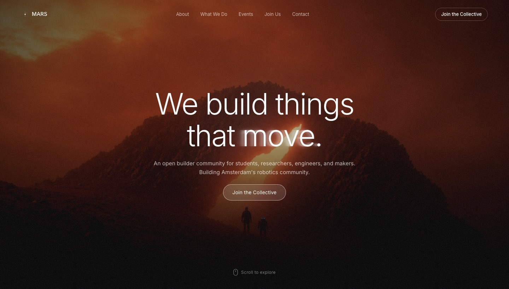

<div align="center">


# MARS

**Makers And Robotics Society, Amsterdam**

We build things that move.

[](https://www.marsrobotics.eu)
[](https://nextjs.org)
[](https://www.typescriptlang.org)
[](https://vercel.com)
[](https://github.com/marsrobotics-eu/website/releases)

<br />

<a href="https://www.marsrobotics.eu"></a>

</div>

<br />

This is the source for [marsrobotics.eu](https://www.marsrobotics.eu), the home of MARS: an open builder community for students, researchers, engineers, and makers building Amsterdam's robotics community.

## Contents

- [Quick start](#quick-start)
- [Tech stack](#tech-stack)
- [Project structure](#project-structure)
- [Editing the site](#editing-the-site)
- [Deployment](#deployment)
- [Security](#security)
- [Contributing](#contributing)

## Quick start

You need [Node.js](https://nodejs.org) 20.9 or newer.

```bash
git clone https://github.com/marsrobotics-eu/website.git
cd website
npm install
npm run dev
```

Open [http://localhost:3000](http://localhost:3000). Changes show up as you save.

| Command             | What it does                                  |
| ------------------- | --------------------------------------------- |
| `npm run dev`       | Start the dev server with hot reload          |
| `npm run build`     | Production build, also runs the type checker  |
| `npm run start`     | Serve the production build locally            |
| `npm run typecheck` | Type check only                               |

## Tech stack

| Layer      | Choice                                                          |
| ---------- | --------------------------------------------------------------- |
| Framework  | [Next.js 16](https://nextjs.org) with the App Router            |
| UI         | React 19, TypeScript in strict mode                             |
| Styling    | Plain CSS in one file, `app/globals.css`                        |
| Font       | Inter, self-hosted through `next/font` (no Google requests)     |
| Rendering  | Prerendered to static HTML at build time, fast and SEO-friendly |
| Hosting    | Vercel, with automatic deploys from GitHub                      |

## Project structure

```
app/
  layout.tsx          HTML shell, font, page title, SEO and social card
  page.tsx            Home page: the order of the sections
  globals.css         All styles
components/
  Nav.tsx             Top navigation
  Hero.tsx            "We build things that move." header
  Features.tsx        Build / Learn / Compete
  UseCases.tsx        Tabbed use cases
  HowItWorks.tsx      Three steps to get involved
  About.tsx           The story behind MARS
  Team.tsx            Founders
  Benefits.tsx        Why join
  FAQ.tsx             Questions and answers
  CTABanner.tsx       Closing call to action
  Footer.tsx          Footer
  Reveal.tsx          Fade-in-on-scroll animation
public/
  assets/images/      Logos, backgrounds, team photos
docs/                 Images used in this README
vercel.json           Framework and security headers
```

Components render on the server by default. Only the ones that need the browser (`Nav`, `Hero`, `FAQ`, `UseCases`, `Reveal`) start with `'use client'`.

## Editing the site

| I want to change...            | Edit this                                                |
| ------------------------------ | -------------------------------------------------------- |
| Text in a section              | The matching file in `components/`                       |
| The order of sections          | `app/page.tsx`                                           |
| Team members                   | `components/Team.tsx`, photos in `public/assets/images/` |
| Questions and answers          | `components/FAQ.tsx`                                     |
| Colors, fonts, spacing         | `app/globals.css`                                        |
| Page title, social preview     | `metadata` in `app/layout.tsx`                           |
| Add a new page, e.g. `/events` | Create `app/events/page.tsx`                             |

Images go in `public/assets/images/` and are referenced as `/assets/images/<file>`.

For any text visitors read, follow the writing guidelines in [`AGENTS.md`](AGENTS.md) and [`.claude/clean-text.md`](.claude/clean-text.md).

## Deployment

Vercel deploys this repo automatically. There is nothing to run by hand.

| You push to...         | Result                                                      |
| ---------------------- | ----------------------------------------------------------- |
| `master`               | Goes live on [marsrobotics.eu](https://www.marsrobotics.eu) |
| Any other branch or PR | Gets its own preview URL, posted on the PR                  |

`marsrobotics.eu` redirects to `www.marsrobotics.eu`. If a deploy breaks something, roll back to the previous one in the Vercel dashboard under Deployments.

## Security

- The site is static. No backend, no database, no user data, no API keys.
- Never commit secrets. If one is ever needed, add it as an environment variable in Vercel, not in the code.
- `vercel.json` sets strict security headers: Content Security Policy, no framing, no MIME sniffing, a strict referrer policy, and camera, mic and location turned off.
- GitHub secret scanning, push protection and Dependabot security updates are on for this repo.

Found a security issue? Please email the team instead of opening a public issue.

## Contributing

1. Create a branch off `master`.
2. Make your change and check it with `npm run dev`.
3. Run `npm run build` to make sure it builds and type checks.
4. Open a pull request. Vercel posts a preview link so the team can see it before it goes live.

<div align="center">
<br />
<sub>Made in Amsterdam by the MARS team.</sub>
</div>
